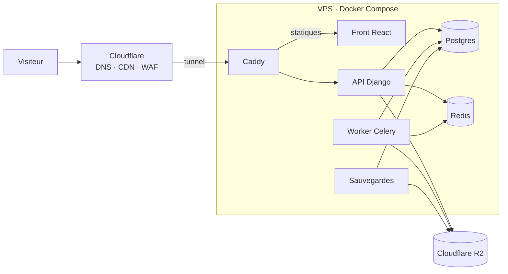

# pacome.dev

Le code source de mon portfolio, en ligne sur **[pacome.dev](https://pacome.dev)**.

Le site présente mes projets, chacun avec une fiche technique. Il est aussi le premier projet
qu'il présente : ce dépôt montre comment je conçois, teste, déploie et exploite une application
de bout en bout, et chaque choix y est écrit et justifié.

## Ce que fait le site

- **Une galerie de projets**, et pour chacun une fiche technique faite de sections libres en
  Markdown.
- **Un back-office** (l'admin Django, protégé par un second facteur) où j'ajoute et ordonne
  projets, sections et images. Ajouter un projet ne demande jamais de toucher au code : le
  contenu est de la donnée.
- **Des images** déposées sur Cloudflare R2, dont un worker calcule les versions redimensionnées.

À venir : un chatbot qui répond sur mon parcours à partir de mes documents (RAG avec LangGraph),
puis un serveur MCP pour interroger le portfolio depuis son propre assistant.

## Architecture

- **Aucun port web ouvert** sur le serveur : Cloudflare joint Caddy par un tunnel sortant.
- **Le front est statique**, compilé en CI et servi par Caddy ; il ne parle qu'à l'API.
- **Les sauvegardes sont chiffrées** et envoyées sur R2, et leur restauration est rejouée par un
  workflow dédié.

## Stack

| Couche | Technologies |
|---|---|
| Front | React 19, TypeScript, Vite, Tailwind CSS |
| Back | Python, Django, Django Ninja, Celery |
| Données | PostgreSQL, Redis, Cloudflare R2 |
| Infra | Docker Compose, Caddy, Cloudflare, VPS |
| CI/CD | GitHub Actions, GitHub Container Registry |
| Observabilité | Sentry, logs structurés |

## Qualité

- **Tests** : pytest pour l'API ; Vitest et Playwright pour le front, avec un audit
  d'accessibilité (axe) et Lighthouse CI.
- **Analyse statique** : Ruff et Pyright côté Python, ESLint et TypeScript strict côté front.
- **Sécurité** : en-têtes et CSP stricts, images scannées par Trivy avant publication,
  dépendances suivies par Dependabot.
- **Livraison par version** : chaque merge sur `main` est vérifié ; une release publiée construit
  les images, les vérifie sur une pile de fumée, puis les déploie.

## Les décisions

Chaque choix structurant a son ADR dans [`docs/adr/`](docs/adr/) — le problème, les options
écartées et pourquoi. Le cadrage d'ensemble est dans
[`docs/cadrage-technique.md`](docs/cadrage-technique.md), l'interface dans
[`docs/specification-ux.md`](docs/specification-ux.md).

## Une pipeline de développement par agents IA

Ce projet sert aussi de banc d'essai à une pipeline de développement pilotée par des agents
([Claude Code](https://claude.com/claude-code)) : des issues triées par une machine à états, un
cycle de PR en TDD, des relectures à contexte vierge, des rôles d'agents choisis selon ce qu'ils
ont le droit de décider, et un humain qui garde les décisions de produit et le merge.

- [`CLAUDE.md`](CLAUDE.md) et [`CONTRIBUTING.md`](CONTRIBUTING.md) décrivent le fonctionnement ;
- [`.claude/skills/`](.claude/skills/) contient les skills de la pipeline ;
- [`.claude/agents/`](.claude/agents/) définit les rôles ;
- [`.claude/rules/`](.claude/rules/) porte les règles toujours actives.

L'historique des issues et des PR montre la pipeline au travail.

## Licence

Code et contenu : tous droits réservés. Le dépôt est public pour être lu, pas pour être réutilisé.
